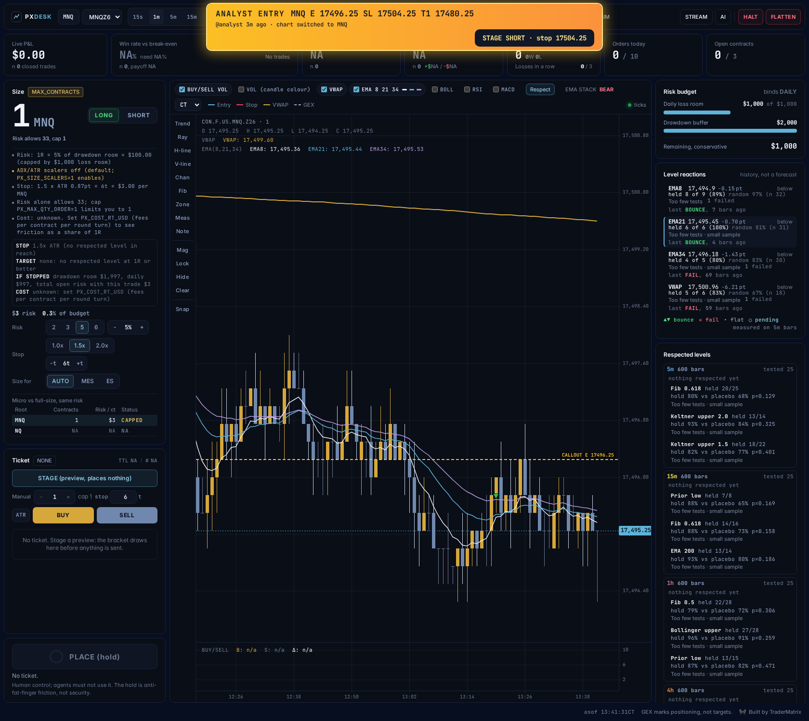
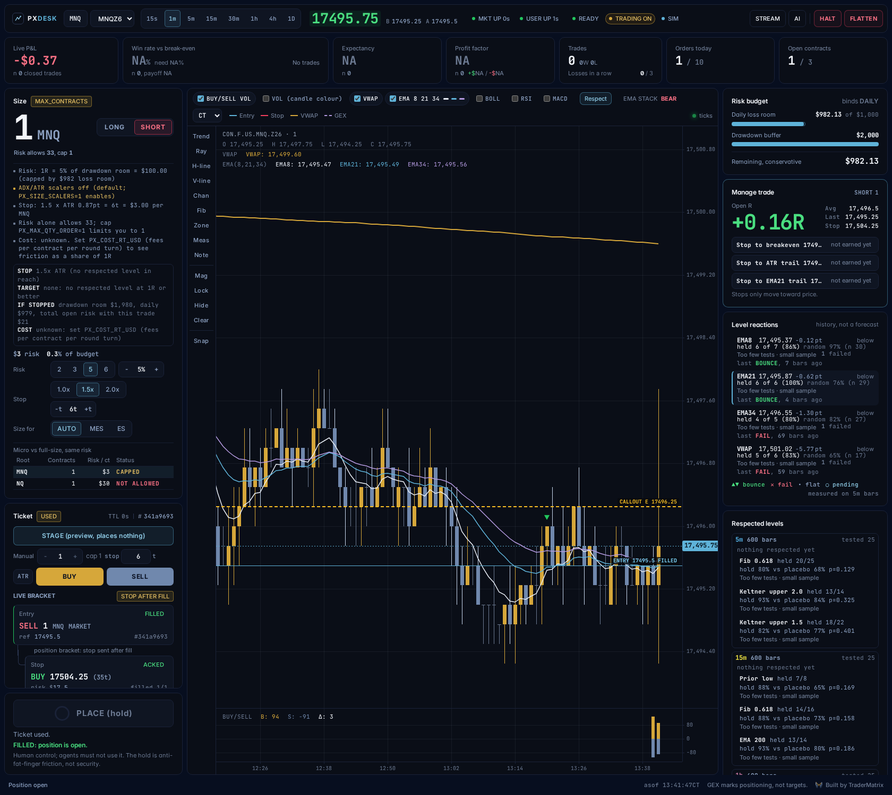
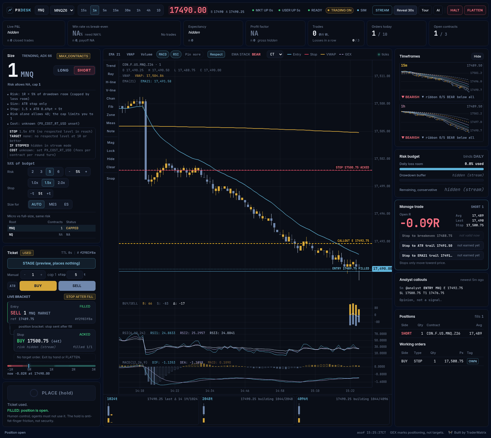
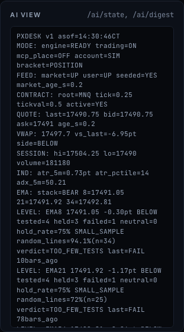
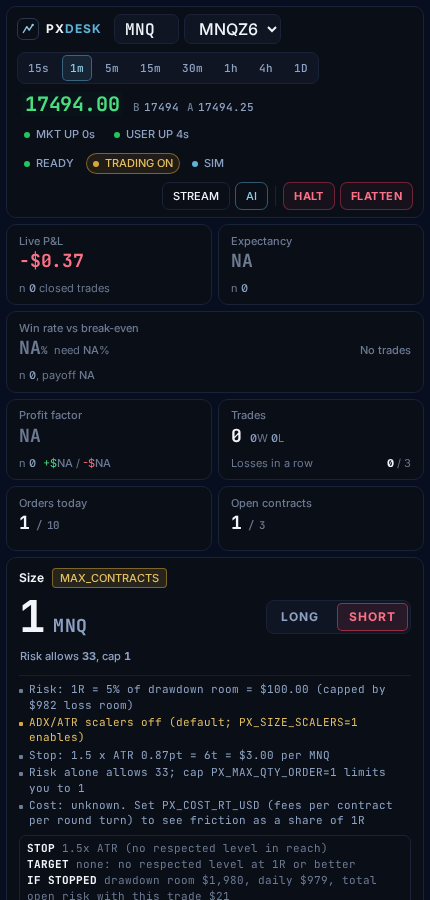

<p align="center">
  <picture>
    <source media="(prefers-color-scheme: dark)" srcset="assets/brand/logo-lockup-on-dark.png">
    
  </picture>
</p>

<h1 align="center">ProjectX Desk</h1>

<p align="center"><b>Position sizing and discipline for TopstepX micro futures.<br>
It sizes every trade from your remaining loss room, refuses what you can't afford,<br>
and locks you out after a losing streak. Free, MIT, runs offline on a practice market.</b></p>

<p align="center">
  <a href="https://github.com/tradernetwork/projectx-desk/actions/workflows/ci.yml"></a>
  
  
  
</p>

<p align="center">
  Built by <a href="https://github.com/mphinance">Michael</a> at <a href="https://www.tradermatrix.pro/?ref=MPHINANCE"><b>TraderMatrix</b></a>. <i>We track the moves. TraderMatrix helps you trade them.</i>
  Unofficial: not affiliated with ProjectX, TopstepX or Topstep.
</p>

**Who it is for:** futures traders on prop-firm evals (the funded-account tests) who want position sizing and discipline
enforced for them, and optionally an AI assistant that can watch the desk and stage ideas but can never place an order.
No signals of its own. No auto-trading.

**What is in it:** one guarded order path (a test fails the build if any other file can place an order); sizing off your loss limit
with an ATR stop that tucks beyond a level price has respected; **real buy and sell volume** built from the trade tape, plus 1024, 2048
and 4096-trade tick charts; GEX levels drawn on the chart; and an **analyst-callout alert** that flashes when a fresh futures entry
posts, switches the chart to it when you are flat, and, if you turn it on (`PX_FEED_STAGE=1`), offers a one-click STAGE (you still hold PLACE yourself).

**Terms:** *R* is the amount you risk on a trade. *ATR* is how far price typically moves. *STAGE* drafts an order; nothing
is sent until you hold *PLACE*. *MCP* is a standard way for AI assistants to use tools. More in the [glossary](#glossary).

<p align="center"></p>

<p align="center"><sub>Practice market with synthetic prices. Nothing on screen is a result.</sub></p>

> **Alpha. Not financial advice.** The order path is tested against the built-in practice market only: **no order has ever been placed
> through a real gateway.** The read side (login, quotes, the trade tape, bars, both hubs) has been run against a real TopstepX Combine
> simulated account. Real accounts are blocked until you turn them on. Read [what is unverified](docs/LIMITATIONS.md) before you
> point it at anything. The code has been reviewed by several AI models and one agent audit ([the results](docs/AUDIT_2026-10-16.md)),
> not yet by a human futures-execution engineer.

## Start here: this is not a website

If you clicked the GitHub link and only saw files and code, that is what GitHub shows. **There is nothing to open from the link.** The desk is a
program that runs **on your own computer**, and you view it in your browser at an address only your computer can see (`http://127.0.0.1:8613`).
That is on purpose: your orders have to come from your own device, so do not put it on a cloud server.

**You need** Python 3.10 or newer and a terminal. No account, no money, no broker: the first run uses a built-in practice market with made-up prices.

1. **Get the code.** Either `git clone https://github.com/tradernetwork/projectx-desk`, or on the GitHub page press the green **Code** button,
   then **Download ZIP**, unzip it, and open a terminal inside the unzipped folder (it is called `projectx-desk-main`).
2. **Install it, once.**
   ```bash
   python3 -m venv .venv && . .venv/bin/activate
   pip install -r requirements.txt
   ```
3. **Start it.**
   ```bash
   ./run_dev.sh
   ```
4. **Open the address it prints** (`http://127.0.0.1:8613/?ai=1`) in your browser. Leave the terminal window open: closing it stops the desk, and `Ctrl+C` stops it too.

You should see a chart, a size box with a number and its reasons, and a **PLACE** button. Pick a risk chip, press **STAGE**, then press and hold **PLACE** for 600 ms.
Watch the fill, the stop being placed and acknowledged, and the trade manager. Try **FLATTEN**, **HALT**, a losing trade (a cooldown starts), and `?stream=1`.

**Windows (PowerShell):** use `run_dev.ps1` instead of `run_dev.sh`, and `py` or `python` instead of `python3`:
```powershell
python -m venv .venv; .venv\Scripts\python -m pip install -r requirements.txt
powershell -ExecutionPolicy Bypass -File run_dev.ps1
```
The full test suite passes on Windows 11 with Python 3.13. WSL works too, with the steps above as written. **Mac and Linux:** the steps work as written;
if `python3` is missing, install Python from [python.org](https://www.python.org/downloads/).

| If you see | Do this |
|---|---|
| Only code files on the GitHub page | Expected. Follow the four steps above; the page itself is not the app. |
| `python3: command not found`, or a version older than 3.10 | Install Python 3.10 or newer. On Ubuntu or WSL: `sudo apt install python3 python3-venv python3-pip`. |
| `ensurepip is not available` or `No module named venv` | `sudo apt install python3-venv`, then repeat step 2. |
| `Permission denied: ./run_dev.sh` | Run `bash run_dev.sh` instead. |
| `The desk did not start` with a log excerpt | Read the last lines it prints. If a port is busy: `CHART_PORT=8623 DEV_GATEWAY_PORT=8710 ./run_dev.sh`. |
| The browser says it cannot connect | The terminal running `run_dev.sh` must still be open, and the address must be the one it printed. |
| The prices look odd or random | They are made up. The practice market is for learning the rules, not for anything about real markets. |

Needs Python 3.10+ (tested on 3.10, 3.11 and 3.13), bash and curl. Linux tested.

**To use it with your real TopstepX account** (after you have tried the practice market, and starting on a simulated account with `PX_TRADING=0`), see [Use it for real](#use-it-for-real).

## Why I built this

My losers were bigger than my winners. Not by a little.

I pulled my own trade history: 42 stock round trips over one month. Average win, $1.50. Average loss, $5.09. To break even at
that ratio you have to win 77% of the time (5.09 / (1.50 + 5.09) = 0.77). I won 45%.

It got worse. After a loss, my next position was 55% bigger than after a win. My worst loss was 5.35 times my average one.
That is before fees.

I did not need a better entry. I needed something that makes the dumb stuff expensive: size set by the math, a stop that has to
exist, a cooldown after a loss, a lockout after three in a row. So I built that, then built a practice market so nobody has to
learn the rules with real money.

It will not make you profitable. It stands between you and the leaks. One month, small sample, gross of fees: the point is the
arithmetic, not the result.

~ Michael

## What you get

| | |
|---|---|
| **It sizes every trade** | From your remaining daily-loss and drawdown room and a stop set by ATR. It always rounds **down**. If one contract risks more than your budget it says `REFUSED`; it never rounds up. |
| **It tells you why** | The size box lists its reasons: your risk %, the ADX and ATR cuts, the stop math, what risk alone would allow versus your cap. |
| **It never locks you out of a hand-sized trade** | BUY and SELL take your own contract count and stop distance (the stop follows the ATR stop until you type one). Same checks, same ticket, same hold to place. If the loss room or a cap allows fewer than you asked, it says how many, it does not quietly shrink the order. |
| **It gets smaller, never bigger** | Nothing scales risk up. Optional cuts for a choppy market (ADX under 20) or a very volatile one (ATR in the top fifth of its recent range) exist but are **off by default**: the stop is already sized by ATR, so the ATR cut priced volatility twice ([why](docs/SIZING.md)). `PX_SIZE_SCALERS=1` turns them on. |
| **It shows what friction costs** | Set `PX_COST_RT_USD` (your fees per contract per round turn) and the size box shows the cost of the trade as a share of 1R and the win rate 1:1 needs after costs. On micros that number is the one that decides. |
| **Guardrails** | Cooldown after a loss, lockout after 3 losses in a row, and after a loss your risk can't exceed what that trade risked. Defaults are settings. |
| **One desk at a time** | A second desk started from the same checkout refuses to run (an exclusive lock on `data/desk.lock`), so two copies cannot place the same trade twice. Two machines on one account are on you. |
| **A stop is required** | Sent right after the fill and watched for 5 seconds; if it is not acknowledged, the desk flattens and halts. If the live feed misses the fill, no stop is sent, so read the limits. |
| **Manage the trade** | Live open R, plus one-click stop moves (breakeven, ATR trail, EMA 21 trail). Stops only move toward price, never wider. |
| **Stats with the fine print** | Win rate sits next to the win rate you need to break even, with the trade count and a SMALL SAMPLE flag under 30 trades. |
| **The chart picks its own indicators** | EMA 21, VWAP and volume are always on. Everything else shows only when it has earned the timeframe on screen: a level (other EMAs, SMAs, Bollinger, Keltner, prior high or low, swing fibs) must be RESPECTED through three statistical gates and sit near price (fibs within 1.5 ATR, the rest within 3), at most three at a time; MACD and RSI appear only while they are ACTIVE (a swing-size check, not an edge claim). "Pin more" forces one on. Every scan is logged to `data/indicator_grades.jsonl` for grading later. |
| **Respected levels (how they are scored)** | For 5m, 15m, 1h, 4h and 1d: which of about 25 candidate levels (EMAs, SMAs, Keltner, Bollinger, VWAP, prior day or week, swing fibs) price has actually reacted to, scored against a calibrated random baseline, with "tested K candidates" beside the winners and a STABLE badge only if the level passes in both halves of the data. Winners are drawn on the chart (toggle: Respect). History, not a forecast. |
| **Timeframes** | The main chart opens on 5m (switch freely); two mini charts (15m, 1h) with the full EMA ribbon 8/13/21/34/55/89 and a bias line: `ribbon N/5 BULL / BEAR / MIXED`, which EMAs price is above, and a BULLISH / BEARISH / NEUTRAL badge that needs the whole ribbon in order. |
| **Trending or ranging** | A chip by the Size heading reads TRENDING or RANGING from the 5m ADX (below 20 is the sit-out zone). Size is the ATR stop only; the chip is advice and never blocks an order. |
| **Trend context (not a signal)** | A chip by the EMA badge and a strip in the top ribbon (one chip per tracked contract; click one to switch the chart) read a direction and a letter from the 5m, 15m and 1h EMA stacks, VWAP side, tape delta and where price sits against the 21 EMA (a pullback scores, chasing does not). A `!` means a caution flag is active; hover for the reasons. It has **not been backtested** (the first version showed no follow-through edge, see [Round 17](docs/DECISIONS.md)), it never gates or sizes an order, and every read is logged to `data/bias_log.jsonl` so it can be tested out of sample. |
| **Limit orders by right-click** | Right-click the price pane to stage a limit entry at that price (simulated accounts only, within 20 ticks of the market, with the quantity and stop from the Manual row). Same preview, ticket and 600 ms hold as every order. There is no cancel button yet: FLATTEN cancels a resting limit on a simulated account. |
| **Cash open and opening range** | A marker at 08:30 CT, with the first 15 minutes shaded and extended to the right, on 1m, 3m, 5m and 15m charts. A fixed US-stock-market reference: it is not tuned for gold or crude. |
| **Real buy and sell volume** | A volume pane built from the trade tape's aggressor side (who hit the bid or the ask), not candle colour, plus delta. ProjectX has no tick history, so it records from the moment the desk starts, saves every minute to a SQLite file (`data/flow.db`, 90 days by default), and shows a gap as a gap, never as a wrong number. |
| **Tick charts** | 1024, 2048 and 4096-trade bars built from the same tape, in a strip under the main chart so all six charts (main, 15m, 1h and the three tick charts) are on screen at once. They start empty when the desk starts. |
| **Tracked contracts** | `PX_TRACK_ROOTS` (default `MES,MNQ,MGC`) records those tapes and rescans the indicators every 5 minutes with no browser open, so switching contract does not start from empty. It also feeds the trend strip and the bias log. |
| **Phone alerts** | Install it as an app and get push notifications on halt, flatten, fills, stop hits or failures, low loss room and a dead feed (analyst callouts and regime flips are opt-in). Fixed short messages with no account details. Needs HTTPS, for example Tailscale; see `docs/DEPLOY.md`. Not yet verified on a real phone. |
| **Guided tour** | The Tour button highlights each part of the desk and says what it does. It only draws an overlay and swallows clicks while open, so it cannot place or halt anything. |
| **GEX on the chart** | Flip, pin and walls from the TraderDaddy API, converted to futures prices and drawn as labelled lines. Display only: they never feed sizing, stops or targets. |
| **Analyst alert** | When a fresh futures ENTRY callout posts (Discord bot feed), a banner flashes, the chart switches to that contract if you are flat, the analyst's entry, stop and first target are drawn. With `PX_FEED_STAGE=1` a STAGE button offers their trade through the normal ticket; it is off by default because the feed is an unmeasured signal and should not be the easiest entry on the screen. PLACE is still your 600 ms hold. |
| **Level-anchored stop and target** | The stop tucks just beyond a level price has respected (never tighter than 1.5x ATR, never wider than 2x); the target is the nearest respected level at 1R or better, with its R:R and break-even win rate. |
| **Practice market** | A built-in mock ProjectX gateway with fills, resting stops, and switches that force timeouts, rejections and dropped feeds. |
| **On camera** | Stream mode removes balance, P&L and risk dollars from the page. |
| **AI-ready** | A plain-text digest and an MCP server for assistants. They can read and stage. Only you place. |

## What it does not model

If you are on an eval, know what the numbers are:

- **Daily loss is a number you type in, and you maintain the drawdown floor.** With `PX_MLL_FLOOR` the drawdown room follows your
  live balance, but the desk does not read your firm's limits, compute Topstep's end-of-day trailing floor, or model a consistency
  rule. Treat its budget as an upper bound that you keep updated.
- **Open P&L is marked from the last quote, by the desk.** An open loss shrinks the room (and a position the desk cannot value makes
  the room unknown and refuses opens). It is the desk's mark, not the firm's: a gap through your stop can still breach before anything
  here reacts.
- Built for the ProjectX Gateway API that TopstepX uses. Other ProjectX-based firms may work; untested.

More in [known limitations](docs/LIMITATIONS.md).

<table>
<tr>
<td width="33%"></td>
<td width="34%"></td>
<td width="33%"></td>
</tr>
<tr>
<td><sub>Every size comes with its reasons.</sub></td>
<td><sub>The entry, the stop, and whether it is acknowledged.</sub></td>
<td><sub>Stop moves that can only tighten.</sub></td>
</tr>
</table>


<sub>Offline practice market (synthetic prices), flat. Nothing on screen is a result.</sub>



<sub>A fresh analyst entry: the banner flashes, the chart switches to that contract when you are flat, their entry and stop are drawn, and (with
`PX_FEED_STAGE=1`, as in this screenshot) STAGE drafts the trade through the normal ticket. Placing is still a 600 ms hold by you.</sub>



<table>
<tr>
<td width="50%"></td>
<td width="25%"></td>
<td width="25%"></td>
</tr>
<tr>
<td><sub>Stream mode hides balance, P&amp;L and risk dollars.</sub></td>
<td><sub>What an AI assistant reads.</sub></td>
<td><sub>Narrow screens.</sub></td>
</tr>
</table>

<sub>Screenshots are regenerated from the offline mock desk by <code>scripts/screenshots.py</code> (Playwright; see
<code>requirements-screenshots.txt</code>). They never show a real account.</sub>

## Connect an AI assistant

The MCP server mounts at `/mcp/` once you set a strong token, and `./run_dev.sh` prints a ready-to-paste command:

```bash
claude mcp add --transport http projectx http://127.0.0.1:8613/mcp/ --header "Authorization: Bearer $PX_MCP_TOKEN"
```

Tools: `get_digest`, `get_state`, `get_positions`, `get_orders`, `get_quote`, `get_bars`, `search_contracts`,
`get_risk_status`, `size_trade`, `preview_order` (stages a ticket for you to review) and `halt`. There is no place,
flatten, cancel or clear-halt tool. Plain-text options: `GET /ai/digest`, `GET /ai/state`, `GET /llms.txt`.
Full guide, tool list and digest reference: [docs/AI_AGENTS.md](docs/AI_AGENTS.md).

<details>
<summary><b>What an assistant reads</b> (an excerpt of the real digest, practice-market data)</summary>

```
MODE: engine=READY trading=ON mcp_place=OFF account=SIM bracket=POSITION
QUOTE: last=5004.5 bid=5004.5 ask=5004.75 age_s=0.2
IND: atr_5m=0.9pt atr_pctile=100 adx_5m=55.89
SIZE_WHY: Risk: 5% of $1,000 remaining = $49.98
SIZE_WHY: ADX 55.9 >= 20: trending enough, no cut (x1)
SIZE_WHY: ATR in the 100th percentile: volatile, wide stops (x0.67)
SIZE_WHY: After cuts: $33.49 (x0.67)
SIZE_WHY: Stop: 1.5 x ATR 0.90pt = 6t = $7.50 per MES
SIZE_WHY: Risk alone allows 4; cap PX_MAX_QTY_ORDER=1 limits you to 1
SIZE_RESULT: contracts=1 risk_usd=7.5 pct_budget=0.8 binds=MAX_CONTRACTS risk_allows=4 cap=1
BEHAVIOR: consecutive_losses=0 cooldown_s=0 locked=NO size_locked=NO
MANAGE: LONG 1 avg=5000.25 last=5004.5 stop=4997.25 open_R=1.42 (stops only tighten)
TRADE: state=PLACED acked=YES side=LONG size=1 filled=1 entry_ref=5000.25 stop=4997.25 stop_state=ACKED
RULE: agent reads and stages; the operator places. Voice never confirms.
```
</details>

## Topstep rules

The desk was built for TopstepX. [docs/TOPSTEP_RULES.md](docs/TOPSTEP_RULES.md) lists each Topstep rule with its official source and says plainly whether the desk enforces it, takes a number from you, or leaves it to you. The ones that can end an account: the maximum loss limit (`PX_MLL_FLOOR`), flat by 3:10 PM CT (`PX_FLAT_BY`), and where an order may originate from (your own device, not a cloud server).

## How it fits together

<p align="center"></p>

## Safety model

| Rule | How it is enforced |
|---|---|
| One module places orders | Every order write is in `projectx_desk/guard.py`. A test fails if another module names an order endpoint, reaches the raw HTTP client or token, or calls the write method. It is a tripwire, not a proof: review new network code by hand. |
| Nothing is on by default | `PX_TRADING=0`. A zero or blank money or quantity limit refuses opens. Brackets are never guessed: `PX_BRACKET_MODE` must be set. (The two behavioral rails can be switched off by setting them to 0.) |
| Preview, then place | A hashed, single-use, 120 second ticket. `place()` takes a ticket id, never an order. |
| Writes are never re-sent | The client makes exactly one HTTP attempt per order write and never replays it. An ambiguous entry becomes `UNKNOWN`, writes a persistent halt, and waits for a human. Stop handling can send further, different orders, and so can flatten if you opt in to the fallback; see [limitations](docs/LIMITATIONS.md). |
| Protection after a restart | After boot and every REST resync the desk checks each open position. One with a known ticket gets its stop armed or resized; one already covered by a broker-side stop is left alone; one from the desk's own persisted intent with no provable stop is flattened and the desk halts. A position the desk never placed is reported `EXTERNAL_UNPROTECTED` and never touched. Not run against the real gateway. |
| One owner per position | A second entry on a contract is refused while it has a position, a working order or an entry in flight. Scale-in is not supported. |
| Flatten fallback is opt-in | Flatten cancels working orders on a sim contract (even with no position), then re-reads the book to verify. If `closeContract` cannot be confirmed the desk halts and tells you to close in the TopstepX UI. The automatic opposite-side market order exists only behind `PX_FLATTEN_FALLBACK=1`, default `0`. |
| Fresh state at place | Feed up, quote under 2 seconds old, broker positions match the desk's view, and market entries are refused if price moved more than 8 ticks since staging. |
| Stops only tighten | Toward price only, never into the market. Simulated accounts only. |
| Loopback by default | Binds `127.0.0.1`; foreign hosts and origins get a 403. **On loopback there is no login:** anything that can reach the port can stage and place within your caps, including an AI agent with a shell. Any other bind (Docker, an LXC) refuses to start without `PX_OPERATOR_TOKEN` and `PX_ALLOWED_HOSTS`; the token is then a login in front of everything except MCP. Put TLS in front. See [docs/DEPLOY.md](docs/DEPLOY.md). |

<p align="center"></p>

Nothing in a browser can tell an AI extension's click from a human's, so the 600 ms hold is anti-fat-finger, not security.
The reasoning behind every rule, including what is decided but not yet built, is in [docs/DECISIONS.md](docs/DECISIONS.md).

## Run it in Docker or an LXC

Set `PX_HOST=0.0.0.0` and the desk insists on a strong `PX_OPERATOR_TOKEN` and a `PX_ALLOWED_HOSTS` list before it will start.
Compose file, systemd unit, Tailscale and Caddy setups: [docs/DEPLOY.md](docs/DEPLOY.md). The container files have not been run on
my machine yet; CI builds them.

## Use it for real

Login needs the pair `PROJECTX_USERNAME` + `PROJECTX_API_KEY`. `PROJECTX_USERNAME` is the username you sign in to your firm's
platform with (TopstepX): not your email, not an account name or id. Both go in `.env.projectx`.

Start on a simulated account with `PX_TRADING=0` so the desk can look but not place. Step-by-step:
[docs/GETTING_STARTED_LIVE.md](docs/GETTING_STARTED_LIVE.md). Check your firm's rules on automation first. Run it with
`python -m projectx_desk` from the checkout. Because the buy/sell volume and tick charts are recorded live and ProjectX keeps no tick history,
**every minute the desk is not running is a gap you cannot fill**: run it as a service so closing a terminal does not stop it
([docs/DEPLOY.md](docs/DEPLOY.md)).

<details>
<summary><b>How it is built</b></summary>

FastAPI serves the desk and the data; a vanilla-JS front end (no build step) draws it with KLineChart. A SignalR client keeps
live state from the user and market hubs and resyncs from REST after any interruption. `projectx_desk/guard.py` runs the order path;
`projectx_desk/sizing.py` and `projectx_desk/levels.py` are pure math with no I/O; `projectx_desk/mcp.py` is the MCP server; `projectx_desk/dev_gateway.py` is the practice
market, and it also drives the end-to-end tests. File-by-file layout and the rules for contributors: [AGENTS.md](AGENTS.md).
Sizing details: [docs/SIZING.md](docs/SIZING.md).

```bash
pip install -r requirements-dev.txt
pytest -q            # run offline against the practice market, no broker and no credentials
```
</details>

<details>
<summary><b>GEX on futures</b></summary>

`projectx_desk/gex_futures.py` converts dealer-gamma levels (flip, pin, walls) from SPX, SPY, QQQ, IWM and DIA into ES, NQ, RTY and YM
price space. It refuses stale data and never picks between two flips. `projectx_desk/gex.py` is the provider: it pulls the levels from the
[TraderMatrix / TraderDaddy](https://www.tradermatrix.pro/?ref=MPHINANCE) API (set `PX_GEX_KEY`), draws them on the chart and lists them in the AI digest.
Display only: GEX marks positioning, not targets, and never touches sizing, stops or orders. See [docs/GEX_FUTURES.md](docs/GEX_FUTURES.md).
</details>

<details id="glossary">
<summary><b>Glossary</b></summary>

- **ProjectX / TopstepX:** the trading platform and API that TopstepX evaluations run on.
- **Mock gateway / practice market:** a fake version of the broker's API on your computer, so you can try everything with no account.
- **Stage / ticket:** a draft order. Staging sends nothing; you place it.
- **MCP:** a standard way for AI assistants to use tools.
- **ATR / ADX:** how much price typically moves / how strongly it is trending. The desk uses them to size and to cut size.
- **R:** one unit of the risk you took. +2R means you are up twice what you risked.
- **Bracket (OCO):** an entry with a protective stop attached; OCO means one cancels the other.
- **Flatten:** close everything now. **Halt:** stop opening new trades.
- **UNKNOWN:** the broker's reply was unclear, so the desk stops instead of risking a duplicate order.
- **GEX, flip, pin, walls:** price levels derived from options dealers' positioning.
- **Loopback:** reachable only from your own computer.
</details>

<details>
<summary><b>Related projects</b></summary>

Other ProjectX / TopstepX work worth knowing about: [tsxapi4py](https://github.com/mceesincus/tsxapi4py),
[projectx-sdk-python](https://github.com/ChristianJStarr/projectx-sdk-python),
[projectx-api](https://github.com/rundef/projectx-api) (Python),
[project-x-py](https://github.com/TexasCoding/project-x-py) (Python),
[projectx-rs](https://github.com/SharurTrading/projectx-rs) (Rust),
[MarqSpec.Mcp.TopstepX](https://github.com/adammarquette/MarqSpec.Mcp.TopstepX) (an MCP server) and
[topstepx-skill](https://github.com/blindsipher/topstepx-skill) (a Claude skill).
</details>

## Disclaimer

This is software, not advice. Nothing here is financial advice or a recommendation to buy or sell any security or contract.
Futures trading involves substantial risk of loss and is not suitable for all investors. Past performance, including any
figures shown in demo screenshots (which are synthetic), does not indicate future results. Provided "as is" under the MIT
license, without warranty. You are responsible for your own trading and for your firm's rules.

The TraderMatrix name and logos are trademarks of TraderMatrix and are not covered by the MIT license
([assets/brand/README.md](assets/brand/README.md)). Third-party notices: [NOTICE](NOTICE) and [LICENSES/](LICENSES/Apache-2.0.txt).

---

<p align="center"><sub>Part of the <a href="https://tradernetwork.io">TraderMatrix network</a> · <a href="https://www.tradermatrix.pro/?ref=MPHINANCE">tradermatrix.pro</a> · Links to TraderMatrix.Pro carry a referral code (MPHINANCE). It costs you nothing and helps fund this project. The desk itself has no ads, no trackers and no paywall.</sub></p>
