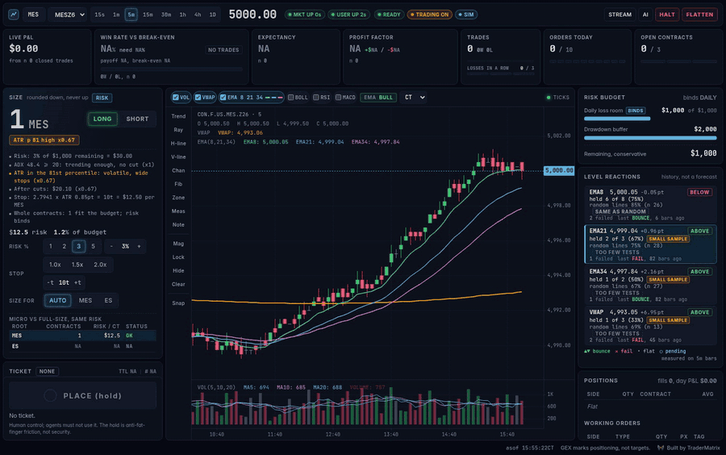
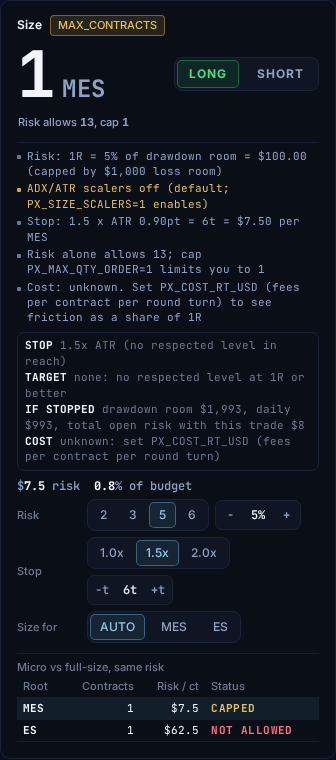
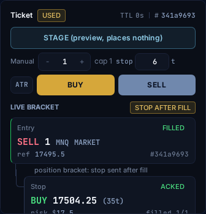
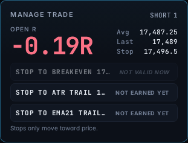
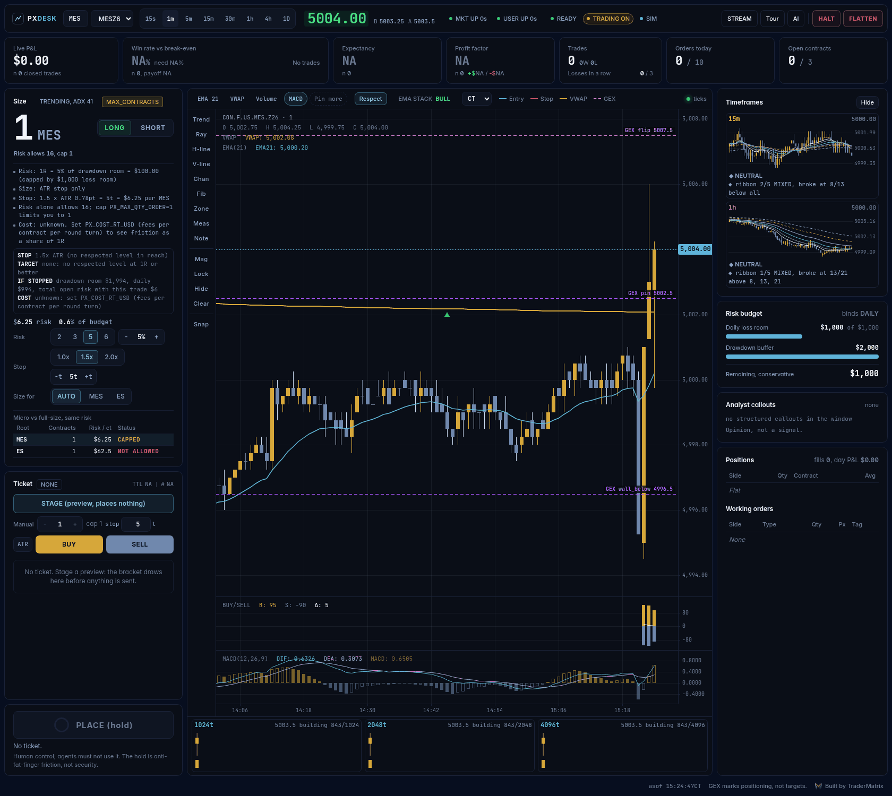
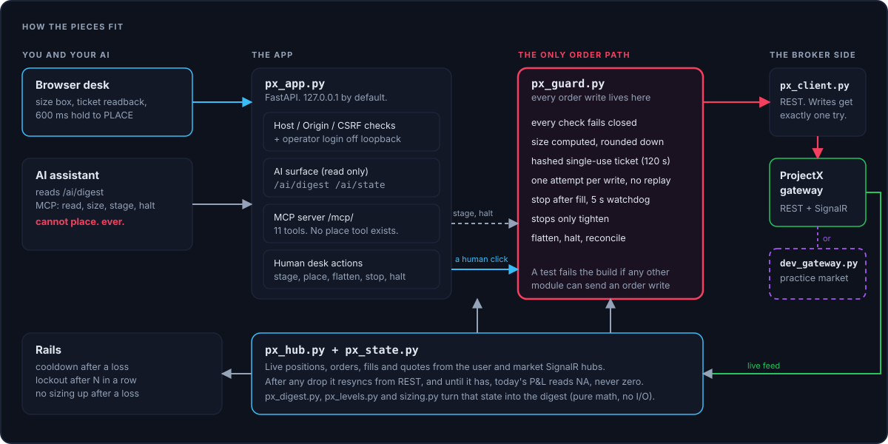
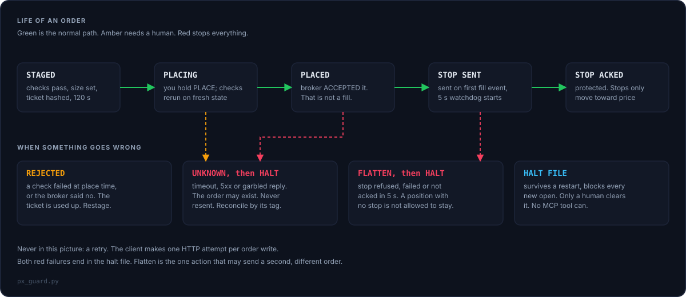

<p align="center">
  <picture>
    <source media="(prefers-color-scheme: dark)" srcset="assets/brand/logo-lockup-on-dark.png">
    
  </picture>
</p>

<h1 align="center">ProjectX Desk</h1>

<p align="center"><b>Position sizing and discipline for TopstepX micro futures.<br>
It sizes every trade from your remaining loss room, refuses what you can't afford,<br>
and locks you out after a losing streak. Free, MIT, runs offline on a practice market.</b></p>

<p align="center">
  <a href="https://github.com/tradernetwork/projectx-desk/actions/workflows/ci.yml"></a>
  
  
  
</p>

<p align="center">
  Built by <a href="https://github.com/mphinance">Michael</a> at <a href="https://www.tradermatrix.pro"><b>TraderMatrix</b></a>.
  Unofficial: not affiliated with ProjectX, TopstepX or Topstep.
</p>

**Who it is for:** futures traders on prop-firm evals (the funded-account tests) who want position sizing and discipline
enforced for them, and optionally an AI assistant that can watch the desk and stage ideas but can never place an order.
No signals. No auto-trading.

**Terms:** *R* is the amount you risk on a trade. *ATR* is how far price typically moves. *STAGE* drafts an order; nothing
is sent until you hold *PLACE*. *MCP* is a standard way for AI assistants to use tools. More in the [glossary](#glossary).

<p align="center"></p>

<p align="center"><sub>Practice market with synthetic prices. Nothing on screen is a result.</sub></p>

> **Alpha. Not financial advice.** Tested against the built-in practice market only. Not yet run against a real TopstepX
> account, and real accounts are blocked until you turn them on. Read [what is unverified](docs/LIMITATIONS.md) before you
> point it at anything.

## Try it in two minutes (no account needed)

```bash
git clone https://github.com/tradernetwork/projectx-desk && cd projectx-desk
python3 -m venv .venv && . .venv/bin/activate
pip install -r requirements.txt
./run_dev.sh            # starts a practice market and the desk, then prints the address
```

Open the address it prints (`http://127.0.0.1:8613/?ai=1`). Pick a risk chip, press **STAGE**, then press and hold
**PLACE** for 600 ms. Watch the fill, the stop being placed and acknowledged, and the trade manager. Try **FLATTEN**,
**HALT**, a losing trade (a cooldown starts), and `?stream=1`.

Needs Python 3.10+ (tested on 3.10, 3.11 and 3.13), bash and curl. Linux tested; on Windows use WSL.

## Why I built this

My losers were bigger than my winners. Not by a little.

I pulled my own trade history: 42 stock round trips over one month. Average win, $1.50. Average loss, $5.09. To break even at
that ratio you have to win 77% of the time (5.09 / (1.50 + 5.09) = 0.77). I won 45%.

It got worse. After a loss, my next position was 55% bigger than after a win. My worst loss was 5.35 times my average one.
That is before fees.

I did not need a better entry. I needed something that makes the dumb stuff expensive: size set by the math, a stop that has to
exist, a cooldown after a loss, a lockout after three in a row. So I built that, then built a practice market so nobody has to
learn the rules with real money.

It will not make you profitable. It stands between you and the leaks. One month, small sample, gross of fees: the point is the
arithmetic, not the result.

~ Michael

## What you get

| | |
|---|---|
| **It sizes every trade** | From your remaining daily-loss and drawdown room and a stop set by ATR. It always rounds **down**. If one contract risks more than your budget it says `REFUSED`; it never rounds up. |
| **It tells you why** | The size box lists its reasons: your risk %, the ADX and ATR cuts, the stop math, what risk alone would allow versus your cap. |
| **It gets smaller, never bigger** | Choppy market (ADX under 20, meaning no clear trend) or very volatile (ATR in the top fifth of its recent range): risk is cut. Unknown inputs cut it too. Nothing scales risk up. |
| **Guardrails** | Cooldown after a loss, lockout after 3 losses in a row, and after a loss your risk can't exceed what that trade risked. Defaults are settings. |
| **A stop is required** | Sent right after the fill and watched for 5 seconds; if it is not acknowledged, the desk flattens and halts. If the live feed misses the fill, no stop is sent, so read the limits. |
| **Manage the trade** | Live open R, plus one-click stop moves (breakeven, ATR trail, EMA 21 trail). Stops only move toward price, never wider. |
| **Stats with the fine print** | Win rate sits next to the win rate you need to break even, with the trade count and a SMALL SAMPLE flag under 30 trades. |
| **Level reactions** | "Held 5 of 8" for EMA 8/21/34 and VWAP, next to the same test on copies of that line shifted 0.5 to 1.5 ATR away. Reaction history, not a forecast. |
| **Practice market** | A built-in mock ProjectX gateway with fills, resting stops, and switches that force timeouts, rejections and dropped feeds. |
| **On camera** | Stream mode removes balance, P&L and risk dollars from the page. |
| **AI-ready** | A plain-text digest and an MCP server for assistants. They can read and stage. Only you place. |

## What it does not model

If you are on an eval, know what the numbers are:

- **Daily loss and drawdown are numbers you type in.** The desk does not read your firm's limits, track a trailing floor,
  count unrealised P&L, or model a consistency rule. Treat its budget as an upper bound that you keep updated.
- **Realised P&L only.** A large open loser is not counted until it closes.
- Built for the ProjectX Gateway API that TopstepX uses. Other ProjectX-based firms may work; untested.

More in [known limitations](docs/LIMITATIONS.md).

<table>
<tr>
<td width="33%"></td>
<td width="34%"></td>
<td width="33%"></td>
</tr>
<tr>
<td><sub>Every size comes with its reasons.</sub></td>
<td><sub>The entry, the stop, and where you are in R.</sub></td>
<td><sub>Stop moves that can only tighten.</sub></td>
</tr>
</table>



<sub>Practice market, synthetic prices, no trades. Nothing on screen is a result.</sub>

## Connect an AI assistant

The MCP server mounts at `/mcp/` once you set a strong token, and `./run_dev.sh` prints a ready-to-paste command:

```bash
claude mcp add --transport http projectx http://127.0.0.1:8613/mcp/ --header "Authorization: Bearer $PX_MCP_TOKEN"
```

Tools: `get_digest`, `get_state`, `get_positions`, `get_orders`, `get_quote`, `get_bars`, `search_contracts`,
`get_risk_status`, `size_trade`, `preview_order` (stages a ticket for you to review) and `halt`. There is no place,
flatten, cancel or clear-halt tool. Plain-text options: `GET /ai/digest`, `GET /ai/state`, `GET /llms.txt`.
Full guide, tool list and digest reference: [docs/AI_AGENTS.md](docs/AI_AGENTS.md).

<details>
<summary><b>What an assistant reads</b> (an excerpt of the real digest, practice-market data)</summary>

```
MODE: engine=READY trading=ON mcp_place=OFF account=SIM bracket=POSITION
QUOTE: last=5004.5 bid=5004.5 ask=5004.75 age_s=0.2
IND: atr_5m=0.9pt atr_pctile=100 adx_5m=55.89
SIZE_WHY: Risk: 5% of $1,000 remaining = $49.98
SIZE_WHY: ADX 55.9 >= 20: trending enough, no cut (x1)
SIZE_WHY: ATR in the 100th percentile: volatile, wide stops (x0.67)
SIZE_WHY: After cuts: $33.49 (x0.67)
SIZE_WHY: Stop: 1.5 x ATR 0.90pt = 6t = $7.50 per MES
SIZE_WHY: Risk alone allows 4; cap PX_MAX_QTY_ORDER=1 limits you to 1
SIZE_RESULT: contracts=1 risk_usd=7.5 pct_budget=0.8 binds=MAX_CONTRACTS risk_allows=4 cap=1
BEHAVIOR: consecutive_losses=0 cooldown_s=0 locked=NO size_locked=NO
MANAGE: LONG 1 avg=5000.25 last=5004.5 stop=4997.25 open_R=1.42 (stops only tighten)
TRADE: state=PLACED acked=YES side=LONG size=1 filled=1 entry_ref=5000.25 stop=4997.25 stop_state=ACKED
RULE: agent reads and stages; the operator places. Voice never confirms.
```
</details>

## How it fits together

<p align="center"></p>

## Safety model

| Rule | How it is enforced |
|---|---|
| One module places orders | Every order write is in `px_guard.py`. A test fails if another module names an order endpoint, reaches the raw HTTP client or token, or calls the write method. It is a tripwire, not a proof: review new network code by hand. |
| Nothing is on by default | `PX_TRADING=0`. A zero or blank money or quantity limit refuses opens. Brackets are never guessed: `PX_BRACKET_MODE` must be set. (The two behavioral rails can be switched off by setting them to 0.) |
| Preview, then place | A hashed, single-use, 120 second ticket. `place()` takes a ticket id, never an order. |
| Writes are never re-sent | The client makes exactly one HTTP attempt per order write and never replays it. An ambiguous entry becomes `UNKNOWN`, writes a persistent halt, and waits for a human. Flatten and stop handling can send further, different orders; see [limitations](docs/LIMITATIONS.md). |
| Fresh state at place | Feed up, quote under 2 seconds old, broker positions match the desk's view, and market entries are refused if price moved more than 8 ticks since staging. |
| Stops only tighten | Toward price only, never into the market. Simulated accounts only. |
| Loopback by default | Binds `127.0.0.1`; foreign hosts and origins get a 403. **On loopback there is no login:** anything that can reach the port can stage and place within your caps, including an AI agent with a shell. Any other bind (Docker, an LXC) refuses to start without `PX_OPERATOR_TOKEN` and `PX_ALLOWED_HOSTS`; the token is then a login in front of everything except MCP. Put TLS in front. See [docs/DEPLOY.md](docs/DEPLOY.md). |

<p align="center"></p>

Nothing in a browser can tell an AI extension's click from a human's, so the 600 ms hold is anti-fat-finger, not security.
The reasoning behind every rule, including what is decided but not yet built, is in [docs/DECISIONS.md](docs/DECISIONS.md).

## Run it in Docker or an LXC

Set `PX_HOST=0.0.0.0` and the desk insists on a strong `PX_OPERATOR_TOKEN` and a `PX_ALLOWED_HOSTS` list before it will start.
Compose file, systemd unit, Tailscale and Caddy setups: [docs/DEPLOY.md](docs/DEPLOY.md). The container files have not been run on
my machine yet; CI builds them.

## Use it for real

Start on a simulated account with `PX_TRADING=0` so the desk can look but not place. Step-by-step:
[docs/GETTING_STARTED_LIVE.md](docs/GETTING_STARTED_LIVE.md). Check your firm's rules on automation first.

<details>
<summary><b>How it is built</b></summary>

FastAPI serves the desk and the data; a vanilla-JS front end (no build step) draws it with KLineChart. A SignalR client keeps
live state from the user and market hubs and resyncs from REST after any interruption. `px_guard.py` runs the order path;
`sizing.py` and `px_levels.py` are pure math with no I/O; `px_mcp.py` is the MCP server; `dev_gateway.py` is the practice
market, and it also drives the end-to-end tests. File-by-file layout and the rules for contributors: [AGENTS.md](AGENTS.md).
Sizing details: [docs/SIZING.md](docs/SIZING.md).

```bash
pip install -r requirements-dev.txt
pytest -q            # 312 tests; run offline against the practice market, no broker and no credentials
```
</details>

<details>
<summary><b>GEX on futures</b></summary>

`gex_futures.py` converts dealer-gamma levels (flip, pin, walls) from SPX, SPY, QQQ, IWM and DIA into ES, NQ, RTY and YM
price space. It refuses stale data, never picks between two flips, and fetches nothing: bring your own levels.
[TraderMatrix](https://www.tradermatrix.pro) computes GEX, and its free AI-tool (MCP) integration lets developers pull its
GEX data into their own assistant. The desk does not ship a provider yet. See [docs/GEX_FUTURES.md](docs/GEX_FUTURES.md).
</details>

<details id="glossary">
<summary><b>Glossary</b></summary>

- **ProjectX / TopstepX:** the trading platform and API that TopstepX evaluations run on.
- **Mock gateway / practice market:** a fake version of the broker's API on your computer, so you can try everything with no account.
- **Stage / ticket:** a draft order. Staging sends nothing; you place it.
- **MCP:** a standard way for AI assistants to use tools.
- **ATR / ADX:** how much price typically moves / how strongly it is trending. The desk uses them to size and to cut size.
- **R:** one unit of the risk you took. +2R means you are up twice what you risked.
- **Bracket (OCO):** an entry with a protective stop attached; OCO means one cancels the other.
- **Flatten:** close everything now. **Halt:** stop opening new trades.
- **UNKNOWN:** the broker's reply was unclear, so the desk stops instead of risking a duplicate order.
- **GEX, flip, pin, walls:** price levels derived from options dealers' positioning.
- **Loopback:** reachable only from your own computer.
</details>

<details>
<summary><b>Related projects</b></summary>

Other ProjectX / TopstepX work worth knowing about: [tsxapi4py](https://github.com/mceesincus/tsxapi4py),
[projectx-sdk-python](https://github.com/ChristianJStarr/projectx-sdk-python),
[projectx-api](https://github.com/rundef/projectx-api) (Python),
[projectx-rs](https://github.com/SharurTrading/projectx-rs) (Rust),
[MarqSpec.Mcp.TopstepX](https://github.com/adammarquette/MarqSpec.Mcp.TopstepX) (an MCP server) and
[topstepx-skill](https://github.com/blindsipher/topstepx-skill) (a Claude skill).
</details>

## Disclaimer

This is software, not advice. Nothing here is financial advice or a recommendation to buy or sell any security or contract.
Futures trading involves substantial risk of loss and is not suitable for all investors. Past performance, including any
figures shown in demo screenshots (which are synthetic), does not indicate future results. Provided "as is" under the MIT
license, without warranty. You are responsible for your own trading and for your firm's rules.

The TraderMatrix name and logos are trademarks of TraderMatrix and are not covered by the MIT license
([assets/brand/README.md](assets/brand/README.md)). Third-party notices: [NOTICE](NOTICE) and [LICENSES/](LICENSES/Apache-2.0.txt).
