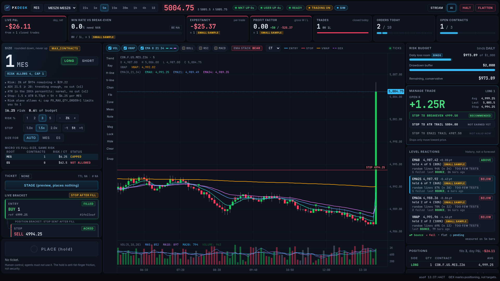
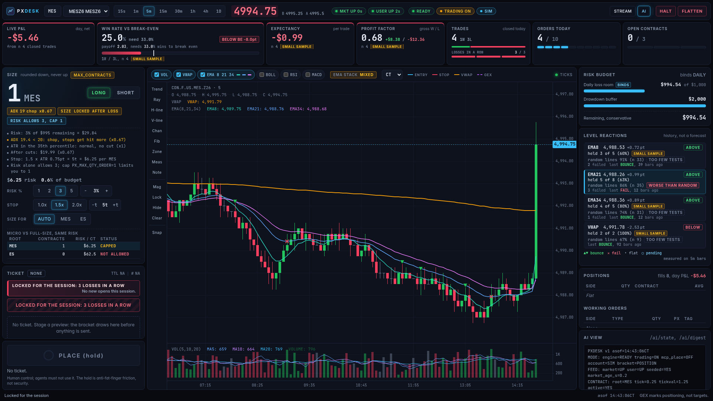
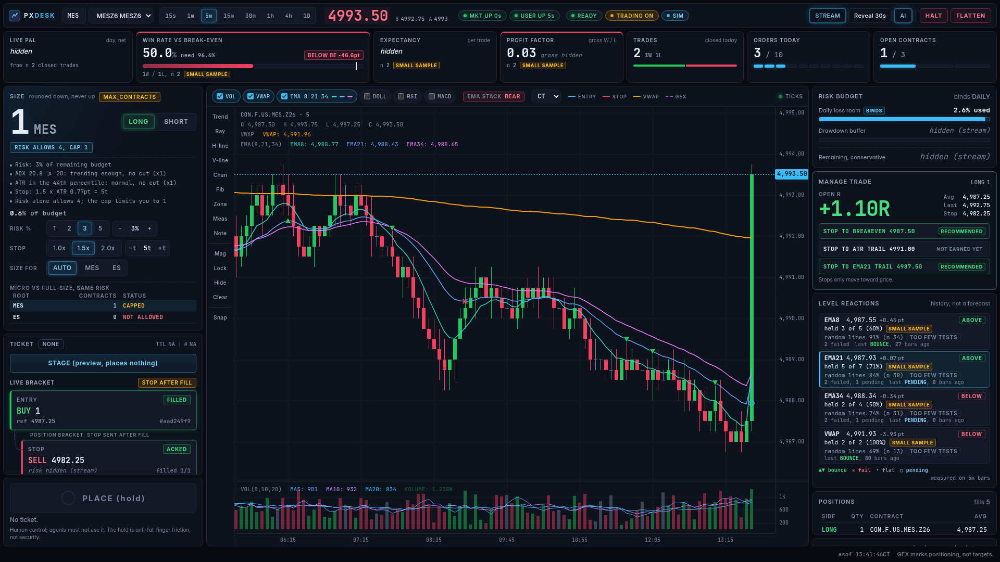

<p align="center">
  <picture>
    <source media="(prefers-color-scheme: dark)" srcset="assets/brand/logo-lockup-on-dark.png">
    
  </picture>
</p>

<h1 align="center">ProjectX Desk</h1>

<p align="center"><b>A guarded futures desk for ProjectX / TopstepX, with a mock gateway you can run offline,<br>an AI-readable panel for agents, and an MCP server that can read and stage but never place.</b></p>

<p align="center">
  <a href="https://github.com/tradernetwork/projectx-desk/actions/workflows/ci.yml"></a>
  
  
</p>

Built by [Michael](https://github.com/mphinance) at **[TraderMatrix](https://www.traderdaddy.pro)**. Unofficial: not affiliated with ProjectX, TopstepX or Topstep.

> **Status: alpha.** Everything here is tested against the bundled mock gateway (see below). It has **not** yet been run
> against the real ProjectX gateway, and live accounts are refused by default. Read [What is unverified](#what-is-unverified) before you point it at an account.



<sub>Synthetic prices and trades from the bundled mock gateway. Not real market data and not performance: the win-rate, P&L and
statistics on screen are demo numbers and do not indicate future results.</sub>

## Why this exists

There are good ProjectX SDKs and API clients already (see [related projects](#related-projects)). What was missing was a
**desk**: something you can run, watch, hand to an AI assistant, and trust not to hurt you.

- **A mock ProjectX gateway** (`dev_gateway.py`): REST plus SignalR, with fills, resting stops, and switches that force a
  place timeout, a rejection, a dropped hub or stale quotes. The whole desk, and its end-to-end tests, run with no account.
- **One module can move money.** Every order write lives in `px_guard.py`, and an AST test fails if any other module names
  an order endpoint or calls the write method.
- **Writes are never replayed.** Any ambiguous outcome (timeout, 5xx, malformed reply, cancellation mid-send) becomes
  `UNKNOWN`, trips a persistent halt, and is reconciled by `customTag`. A duplicate order is worse than a missed one.
- **Position size is computed, always, and rounds down.** If one contract risks more than your budget the desk says
  `REFUSED`, it never rounds up. Every answer carries its reasons: ATR, ADX, the cuts, the stop math, risk-allows vs cap.
- **Rails that only refuse or reduce:** cooldown after a loss, lockout after N straight losses, no sizing up after a loss.
- **Level reactions with a baseline.** "EMA21 held 5 of 8" means nothing alone, so each level is compared with random lines
  near price using the identical rules, with the sample size beside it.
- **Built for AI agents without trusting them.** A plain-text digest and JSON state an agent can read, an `llms.txt`, and an
  MCP server whose tool list has no place, flatten, cancel or clear-halt, by construction.

## Try it in two minutes (offline, no account)

```bash
git clone https://github.com/tradernetwork/projectx-desk && cd projectx-desk
python -m venv .venv && . .venv/bin/activate
pip install -r requirements.txt
./run_dev.sh          # mock gateway + the desk
# open http://127.0.0.1:8613/?ai=1
```

Pick a risk chip, press **STAGE**, then press and hold **PLACE** for 600 ms. Watch the fill arrive, the stop get placed
and acknowledged, and the bracket tree update. Then try **FLATTEN**, **HALT**, a losing trade (cooldown starts), and
`?stream=1` (account and dollar nodes are removed from the page, not hidden).



<sub>Synthetic mock-gateway data, not performance.</sub>

## What an AI agent sees

`GET /ai/digest` is one fact per line, fixed keys, written to be read aloud. An excerpt (synthetic data):

```
PXDESK v1 asof=15:19:20CT
MODE: engine=READY trading=ON mcp_place=OFF account=SIM bracket=POSITION
QUOTE: last=4985 bid=4985 ask=4985.25 age_s=0.2
IND: atr_5m=0.79pt atr_pctile=69 adx_5m=18.49
EMA: stack=BULL 8=4988.99 21=4988.64 34=4988.59
LEVEL: EMA21 4988.64 +0.36pt ABOVE tested=8 held=6 failed=2 hold_rate=75% random_lines=86.1%(n=36) verdict=NOT_DISTINGUISHABLE
SIZE_WHY: Risk: 5% of $1,000 remaining = $50.00
SIZE_WHY: ADX 18.5 < 20: chop, stops get hit more (x0.67)
SIZE_WHY: Stop: 1.5 x ATR 0.79pt = 5t = $6.25 per MES
SIZE_WHY: Risk alone allows 5; cap PX_MAX_QTY_ORDER=1 limits you to 1
SIZE_RESULT: contracts=1 risk_usd=6.25 pct_budget=0.6 binds=MAX_CONTRACTS risk_allows=5 cap=1
BEHAVIOR: consecutive_losses=0 cooldown_s=0 locked=NO size_locked=NO
RULE: agent reads and stages; the operator places. Voice never confirms.
```

`/ai/state` is the same facts as JSON, `/llms.txt` tells an agent what it may and may not do, and the MCP server (`/mcp/`,
bearer token) exposes the same data as tools plus `preview_order`, which **stages** a ticket for a human to review.
Nothing in the page's data comes from gateway free text, so a hostile contract name or order tag cannot become a prompt.

## Safety model, in one screen

| Rule | How it is enforced |
|---|---|
| Only one module can place orders | `px_guard.py`; AST pin in `tests/test_px_guard_pin.py` |
| Kill switches default OFF | `PX_TRADING=0`, `PX_MCP_PLACE=0`; zero or blank limits refuse |
| Preview, then place | hashed, single-use, 120 s ticket; `place()` takes a ticket id, never an order |
| No naked entries | stop required; stop placed after fill with a 5 s watchdog that flattens and halts |
| Never replay a write | `PXClient.write` makes exactly one attempt; ambiguity = `UNKNOWN` + halt |
| Fresh state at place | hub up, quote under 2 s, price drift, broker positions match the desk's view |
| Stops only tighten | `move_stop`: toward price only, never into the market |
| Loopback only | `127.0.0.1`; foreign Host/Origin get 403; POSTs need Origin + JSON + CSRF token |

Nothing in a browser can tell an AI extension's click from a human's, so the 600 ms hold is anti-fat-finger, not
security. The real controls are server-side. The reasoning for every rule, including the ones that were argued over, is in
[docs/DECISIONS.md](docs/DECISIONS.md).

## GEX on futures

`gex_futures.py` converts dealer-gamma levels (flip, pin, walls) computed on SPX/SPY/QQQ/IWM/DIA into ES/NQ/RTY/YM price
space, with an additive basis for cash indices and a ratio for ETFs. It refuses stale or implausible conversions and never
picks between two flips. It fetches nothing: bring your own levels. [TraderMatrix](https://www.traderdaddy.pro) computes GEX,
and its free AI-tool (MCP) integration lets developers pull its GEX data into their own assistant. See
[docs/GEX_FUTURES.md](docs/GEX_FUTURES.md). The desk does not ship a provider yet.



<sub>Stream mode on synthetic data. Built for people who trade on camera. Not performance.</sub>

## Use it for real

1. Copy `.env.projectx.example` to `.env.projectx` and fill it in. Never commit it.
2. **Start on a simulated account.** Set `PX_ACCOUNT_ID`, `PX_ACCOUNT_KIND=sim`, `PX_DAILY_LOSS_LIMIT`, `PX_DRAWDOWN_BUFFER`,
   `PX_NO_NEW_AFTER`, and `PX_BRACKET_MODE` (`position` or `oco`, matching your account's setting).
3. Run `python px_app.py` and watch it read your account before you turn on `PX_TRADING=1`.
4. Check your firm's rules on automation and API use. A rules violation costs the account, not a stop-out.

## What is unverified

Honest list, because the first thing you should do is check it:

- The real gateway's behaviour for: the `Short` position enum (2), the `live` data-subscription flag, bracket-mode
  detection, order cancel/modify on your account type, and whether order search returns `customTag`.
- Live accounts: stop modification and cancel are documented as simulated-only, so live opens require native OCO
  brackets, and the live path is refused until it has been rehearsed.
- The ADX/ATR thresholds and the behavioral-rail defaults are hypotheses, not findings.

## Tests

```bash
pip install -r requirements-dev.txt
pytest -q        # 287 tests, hermetic: no network, no broker, no credentials
```

## Layout

See [AGENTS.md](AGENTS.md) for the file-by-file layout and the rules with teeth. Sizing: [docs/SIZING.md](docs/SIZING.md).

## Related projects

Other ProjectX / TopstepX work worth knowing about: [tsxapi4py](https://github.com/mceesincus/tsxapi4py),
[projectx-sdk-python](https://github.com/ChristianJStarr/projectx-sdk-python),
[projectx-api](https://github.com/rundef/projectx-api) (Python),
[projectx-rs](https://github.com/SharurTrading/projectx-rs) (Rust),
[MarqSpec.Mcp.TopstepX](https://github.com/adammarquette/MarqSpec.Mcp.TopstepX) (an MCP server) and
[topstepx-skill](https://github.com/blindsipher/topstepx-skill) (a Claude skill).

## Disclaimer

This is software, not advice. Nothing here is financial advice or a recommendation to buy or sell any security or contract.
Futures trading involves substantial risk of loss and is not suitable for all investors. Past performance, including any
figures shown in demo screenshots (which are synthetic), does not indicate future results. Provided "as is" under the MIT
license, without warranty. You are responsible for your own trading and for your firm's rules.

The TraderMatrix name and logos are trademarks of TraderMatrix and are not covered by the MIT license
([assets/brand/README.md](assets/brand/README.md)). Third-party notices: [NOTICE](NOTICE).
