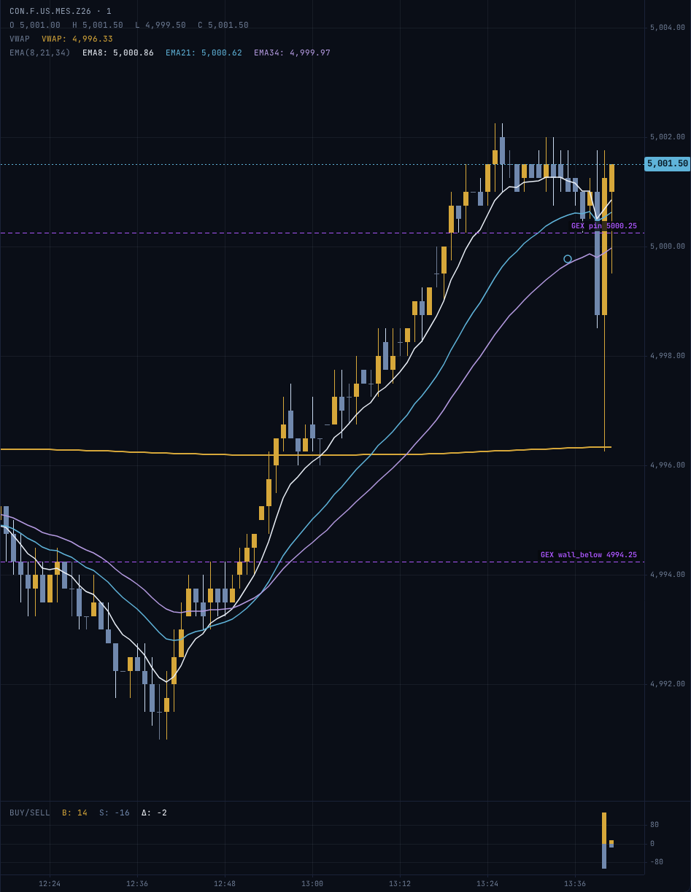

# Futures GEX levels

`projectx_desk/gex_futures.py` converts dealer-gamma (GEX) levels computed on an index or ETF into futures price space, so
they can be drawn on an ES/NQ/RTY/YM chart and listed in the AI-readable panel. Pure math, no I/O: you bring
the levels from whatever GEX source you use.

GEX marks positioning, not targets. The flip is a regime boundary, not a forecast.

Offline practice market with a fake GEX feed: the flip, the pin and a wall as labelled lines on the futures chart.

## Inputs

A levels dict: `spot`, `flip` (or `flip_gex` and `flip_apex` if your source gives two), `pin`, `walls` (a list of
`{"strike": ..., ...}` dicts), and an optional `flip_split` flag. Plus the futures last, the underlying spot,
the tick size and the age of the data in seconds.

## Mapping

| Futures | Preferred source | Fallback | Notes |
|---|---|---|---|
| ES / MES | SPX (cash, additive) | SPY (ratio) | |
| NQ / MNQ | NDX (cash) | QQQ (ratio) | most GEX sources publish QQQ, not NDX |
| RTY / M2K | RUT (cash) | IWM (ratio) | most publish IWM, not RUT |
| YM / MYM | DJX (cash) | DIA (ratio) | most publish DIA, not DJX |
| GC / MGC | GLD (ratio) | none | approximate: GLD is not gold spot |
| CL / MCL | USO (ratio) | none | approximate and refused unless `allow_unsupported=True` |

## Method and why

- Cash index source: ADDITIVE, `level + (futures_last - spot)`. The basis is mostly carry, roughly a constant point offset across nearby strikes.
- ETF source: RATIO, `level * futures_last / spot`. An ETF trades at a fraction of the index, so a point offset is meaningless.
- Results round to the caller's tick size. Output carries `method`, `basis`, `source_symbol`, `approximate`.
- Fails closed. It returns `ok=False, reason, levels=None` when the data is stale (default 300 s; a missing age also refuses), the basis exceeds `max_basis_pct` (default 2%), the ETF ratio is more than 35% off a rough nominal value, or any level or list entry cannot be converted. A stale or half-converted level must never be drawn.
- `flip_split` and every non-price field pass through untouched. Both flips convert independently and the panel prints both. Nothing is ever picked between them.

## Known limits

- Dealer-gamma sources are computed on 0DTE-inclusive index and ETF option chains, not on the futures options themselves, so the levels are a translation, not a measurement of the futures book.
- The ETF ratio check uses hardcoded nominal ratios that drift; a false refusal is possible, and a refusal is the safe failure.
- This module (`gex_futures.py`) does not fetch anything. `projectx_desk/gex.py` is the provider the desk uses: it pulls levels from the TraderDaddy
  API (`PX_GEX_KEY`; see `.env.projectx.example`), tries the preferred source then the fallback in the table above, converts them here, and draws them on
  the chart and in `/ai/digest`. The levels are display only: they never feed sizing, stops or targets. The API key is shared and limited to 30 requests a
  minute, so a failed refresh keeps serving the last good levels (bounded by `PX_GEX_MAX_AGE_S`) instead of blanking the chart.
