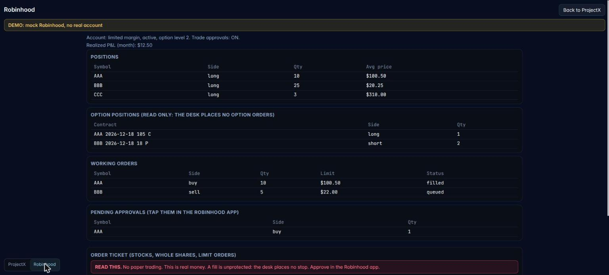
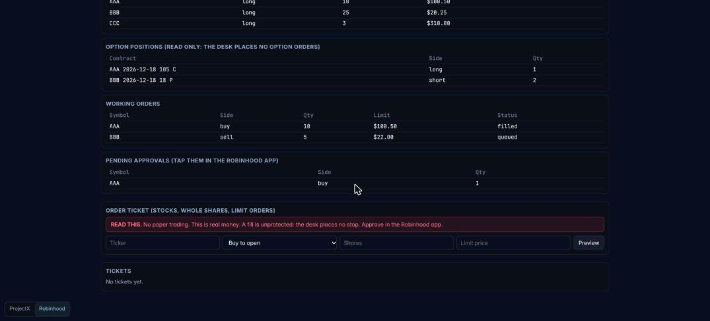

# Robinhood (phase 0: read-only)

Phase 0 reads one Robinhood account through Robinhood's own Trading MCP and shows it in the digest and four GET routes.
It cannot place, cancel or change anything: the client refuses every tool that is not on a fixed read list before a
byte is sent, and `tests/test_px_guard_pin.py` pins every Robinhood write tool name to the guard modules. Order
placement is phase 1 and does not exist yet. Design: `docs/superpowers/specs/2026-11-17-robinhood-broker-design.md`.

## Read this first: the risk statement

- **There is no paper trading on Robinhood.** Every order in phase 1 will be a real order with real money. The
  futures desk has a simulated account to rehearse on; this broker does not.
- **Trade approvals must be ON before phase 1.** Robinhood can require a human to approve each agent order. The desk
  reads that setting (`approval_setting` in `/api/rh/state`) and phase 1 will refuse to place anything while it is off
  or unknown. Turn it on in the Robinhood app now.
- **Use a dedicated, small account.** The MCP only exposes the account you flagged for agent use. Fund it with money
  you can afford to lose entirely. Every other account is dropped before it reaches state, digest or the Ask agent.
- The tool shapes in the mock are modelled on public fixtures and are UNVERIFIED against the live service until you
  run `scripts/rh_capture.py` and compare.

## Try it with no account (demo)

```
./run_dev.sh      # or run_dev.ps1: sets PX_RH=1 PX_RH_MOCK=1, starts a mock Robinhood MCP in-process
curl http://127.0.0.1:8613/api/rh/state
curl 'http://127.0.0.1:8613/ai/digest' | grep '^RH'
```

Every number, symbol and id from the mock is invented. The mock lists write tools (so the drift check has something to
compare) but refuses to run them.

## Real setup

| Variable | Meaning |
|---|---|
| `PX_RH` | ON by default (unset or blank is on). `0`, `false`, `no` or `off` turns the whole feature off: nothing is built, no outbound traffic. On with no token file the desk makes no call and the panel says it is not connected. Placing orders is a separate switch, `PX_RH_TRADING`, which stays `0` by default. |
| `PX_RH_TOKEN_FILE` | Token file, default `data/rh_tokens.json` (mode 0600, gitignored). |
| `PX_RH_POLL_S` | Poll interval, default 30, floor 10. |
| `PX_RH_CALLBACK_PORT` | Fixed loopback port for the sign-in redirect (headless hosts). Default: ephemeral. |
| `PX_RH_URL` | MCP endpoint. Default is Robinhood's. https only; loopback http is allowed for the mock. |
| `PX_RH_MOCK` | Dev only: serve the mock in-process with a pre-issued token. |

The desk polls only when a token file exists. In weekend quiet it stops only when the last snapshot was fully read and
shows no working order and no pending approval; a missing snapshot or any unknown section keeps it polling.

### Sign in on this machine (localhost)

Run `python scripts/rh_capture.py`. With no token file it opens the Robinhood sign-in in your browser, catches the
redirect on `localhost` (an ephemeral loopback port), saves the token pair (atomic, 0600) and writes the tool list.
Then restart the desk (`PX_RH` is on by default; set it to `0` only to switch the feature off).

### Sign in on a headless host (for example venus)

The redirect lands on the machine that started the login, so tunnel it from the laptop:

```
# on the host
PX_RH_CALLBACK_PORT=8765 python scripts/rh_capture.py      # prints the sign-in URL
# on the laptop
ssh -L 8765:localhost:8765 host
# open the printed URL in the laptop browser; the redirect travels through the tunnel
```

The token file stays on the host. Never copy it to a second machine: refresh tokens are single use and rotate, so two
holders break each other. It is UNVERIFIED that Robinhood's client registration accepts a fixed redirect port.

A refresh failure puts Robinhood into read-down (`connected: false`) and asks for a new sign-in. It does not halt
anything, because a failed sign-in creates no exposure.

## What the desk exposes

- `GET /api/rh/state`, `/api/rh/positions`, `/api/rh/orders`, `/api/rh/approvals`. `{"enabled": false}` when off.
  `?stream=1` strips dollar values.
- `RH:` lines in `/ai/digest` and an `rh` key in `/ai/state`: counts, symbols, quantities, approval counts. No account
  number, balance or provider text.
- Phase 1 order routes (below), only when `PX_RH` is on. `PX_RECORD_ONLY` registers none of this, no POST included.

## Phase 1: the order guard (`rh/guard.py`) and its routes

Equities only, whole shares, limit orders, buy to open and sell to close up to the held quantity, one working or pending
order per symbol. A fill is unprotected: the desk owns no stops. A write is sent only when Robinhood's trade-approvals
setting reads ON at the commit point, so the final tap is yours in the Robinhood app. Robinhood has no paper account.

| Env | Default | Meaning |
|---|---|---|
| `PX_RH_TRADING` | 0 | kill switch; blank or garbled is 0 |
| `PX_RH_MAX_NOTIONAL`, `PX_RH_MAX_QTY` | unset | zero, blank or garbled refuses every order (`cap_unset`) |
| `PX_RH_TICKET_TTL_S`, `PX_RH_QUOTE_MAX_AGE_S` | 120, 5 | ticket life, quote freshness |
| `PX_RH_HALT_FILE`, `PX_RH_AUDIT`, `PX_RH_STATE_FILE` | `data/` | separate from ProjectX's halt and audit |

A reply that is not clearly `awaiting_approval` halts Robinhood (`live_order`); a transport error after the send is UNKNOWN
(`place_unknown`), halts, and is never resent. Only a human clears the halt.

After a place the ticket is `awaiting_approval`. `Guard.track()` polls Robinhood's approvals and orders every 15 s (backing
off to 60 s on errors) and moves it to `approved`, `declined`, `expired` or `filled`; declined and expired free the symbol
and the notional budget. An UNKNOWN ticket is looked up by its `ref_id` with `reconcile`; if nothing is found it stays
UNKNOWN and the halt stays until you clear it. Tickets survive a restart (`PX_RH_STATE_FILE`).

### Routes, cancel and release

All POSTs use the desk's Origin + JSON + CSRF gate and answer `{"ok": false, "code": "<fixed word>"}` on a refusal, never
provider text. `GET /api/rh/tickets` lists tickets and the halt word (`?stream=1` drops prices).

| Route | What it does |
|---|---|
| `POST /api/rh/preview` | `{symbol, side, qty, limit_price}` returns a hashed ticket |
| `POST /api/rh/place` | `{ticket_id, confirm_hash}`; the hash is required |
| `POST /api/rh/cancel` | `{ticket_id}` cancels an awaiting, approved or placed order; works while halted; one attempt |
| `POST /api/rh/discard` | `{ticket_id}` drops a previewed (unplaced) ticket so its symbol frees up; nothing is sent to Robinhood |
| `POST /api/rh/reconcile` | `{ticket_id}` looks an UNKNOWN ticket up at Robinhood by its ref id; never resends, never clears the halt |
| `POST /api/rh/release` | `{ticket_id}` human only: frees a ticket whose order and approval both vanished at Robinhood (it checks first) |
| `POST /api/rh/halt/resolve` | human only: clears the Robinhood halt |

Neither the desk's MCP, the Ask box nor the desk agent can reach any of them. A cancel that gets no clear answer is UNKNOWN
and halts (`cancel_unknown`); look at the Robinhood app, then `reconcile` or `release`. Nothing resends a write.

## Phase 1: using the panel

Click **Robinhood** in the switch at the bottom left of the desk (it appears unless `PX_RH=0`). The panel shows the account
type and state (never the number), your trade-approvals setting, positions, option positions (read only), working orders, pending
approvals and every ticket with a plain-words line for its state. In stream mode (`body.streaming`) dollar values are not drawn.

1. Type a ticker, choose Buy to open or Sell to close, whole shares and a limit price, then **Preview**. A refusal is explained in
   plain words (every guard code has a line). A good preview shows the ticket code (hash8), a countdown and the warning: no paper
   trading, a fill is unprotected, approve in the Robinhood app.
2. **Discard** frees the symbol. Otherwise press and hold **PLACE** for 600 ms (a click does nothing; the ticket must have been on
   screen 1.5 s). The order goes to Robinhood and waits for your tap in the Robinhood app.
3. The ticket moves to approved, declined, expired or filled on its own. Cancel, Reconcile, Release and Clear halt show only where the
   state allows them and each asks once. An UNKNOWN ticket means the outcome is unclear and Robinhood is halted: look at the Robinhood
   app, then Reconcile, or Release when the app shows nothing.
4. `PX_RH_DEMO=1` (set by `run_dev.sh`) shows "DEMO: mock Robinhood, no real account". It is a label, not a safety: the mock cannot place.

The Ask box agent cannot read `data/rh_*` or the Robinhood halt file, and cannot reach any Robinhood route.

### Screenshots





Both are the offline mock (`./run_dev.sh`) with invented symbols (AAA, BBB, CCC); no real account was involved. `python scripts/screenshots.py`
(offline mock only, needs Playwright) also has a Robinhood scene for regenerating them.

## Tool drift

```
python scripts/rh_capture.py --out tools-new.json
python scripts/rh_drift.py data/rh_tools.json tools-new.json     # exit 1: a tool the desk calls was removed or gained a required input
```

The capture holds tool names, descriptions and input-schema structure only, never account data.

---

Part of the Momentum Phinance toolchain. Built with [TraderMatrix](https://tradermatrix.pro?ref=MPHINANCE). The link carries a referral code; it costs you nothing.
